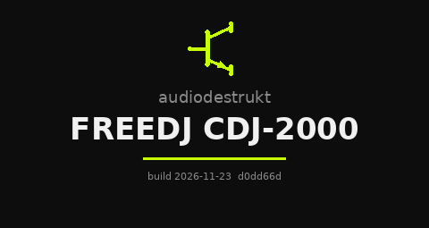

# The screen: the display processor

The CDJ-2000's LCD is driven by its own processor, an **ADSP-BF531**
(Blackfin) with 16 MB of SDRAM and a 2 MB flash, which talks to the main
board over a serial port (SPORT1). As the emulators model it
(cdj-nxs2-qemu `hw/cdj/bfin/bf531.c`, `hw/cdj/boards/cdj2000/display_bf531.c`,
`display_link.c`) and the ADSP-BF531 hardware reference describes the parts.

## Booting it

- The flash is at **0x20000000**. The boot reads an **LDR stream at flash
  +0x10000** (the first 64 KB are the stock boot loader's): blocks of u32
  destination, u32 byte count, u16 flags (0x0001 zero-fill, 0x8000 last), and
  starts the core at **0xFFA08000** (L1 instruction SRAM) after the last.
- `tools/mkflash.py` writes our flash image: our program (`gui/`, built with
  GNU GCC for the Blackfin, `tools/Dockerfile.bfin`) as that stream, and the
  boot splash (`tools/splash.py`) at +1 MB.
- The emulator takes it as `CDJ_BF531_FLASH=build/gui.flash`.

## Showing a frame

The panel takes RGB555 pixels (red in bits 14–10) from the **PPI**, fed by
**DMA0**: 2-D, 480 × 255 16-bit words, autobuffer so it repeats frame after
frame from a framebuffer in SDRAM. Our program copies the splash from flash
into that framebuffer and starts the PPI and DMA0, so the splash is up as soon
as the board boots, before the main board says anything.
`tools/test_splash.py` screendumps the emulated panel and compares every pixel.

⚠ Before a real deck: the PLL and the SDRAM controller are not set up (the
emulator has SDRAM from power-on), and the panel's own sync (the timers that
make its HSYNC/VSYNC, PPI_DELAY) is not matched yet.

## What comes next: the deck's screen

The link to the main board runs at about **2.9 Mbit/s** (360 KB/s), so the
main board can't stream frames (a full one is 245 KB). The display processor
will draw the screen itself: the main board sends a track's waveform once
when it loads, then small updates (the playhead ~30 times a second, the
tempo, BPM and time as they change), and the Blackfin draws the scrolling
waveform every frame.
