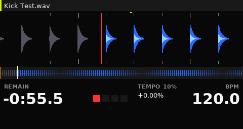

# The screen: the display processor

The CDJ-2000's LCD is driven by its own processor, an **ADSP-BF531**
(Blackfin) with 16 MB of SDRAM and a 2 MB flash, which talks to the main
board over a serial port (SPORT1). As the emulators model it
(cdj-nxs2-qemu `hw/cdj/bfin/bf531.c`, `hw/cdj/boards/cdj2000/display_bf531.c`,
`display_link.c`) and the ADSP-BF531 hardware reference describes the parts.

## Booting it

- The flash is at **0x20000000**. The boot reads an **LDR stream at flash
  +0x10000** (the first 64 KB are the stock boot loader's): blocks of u32
  destination, u32 byte count, u16 flags (0x0001 zero-fill, 0x8000 last), and
  starts the core at **0xFFA08000** (L1 instruction SRAM) after the last.
- `tools/mkflash.py` writes our flash image: our program (`gui/`, built with
  GNU GCC for the Blackfin, `tools/Dockerfile.bfin`) as that stream, and the
  boot splash (`tools/splash.py`) at +1 MB.
- The emulator takes it as `CDJ_BF531_FLASH=build/gui.flash`.

## Showing a frame

The panel takes RGB555 pixels (red in bits 14–10) from the **PPI**, fed by
**DMA0**: 2-D, 480 × 255 16-bit words, autobuffer so it repeats frame after
frame from a framebuffer in SDRAM. Our program copies the splash from flash
into that framebuffer and starts the PPI and DMA0, so the splash is up as soon
as the board boots, before the main board says anything.
`tools/test_splash.py` screendumps the emulated panel and compares every pixel.

⚠ Before a real deck: the PLL and the SDRAM controller are not set up (the
emulator has SDRAM from power-on), and the panel's own sync (the timers that
make its HSYNC/VSYNC, PPI_DELAY) is not matched yet.

## The deck's screen

The link to the main board runs at about **2.9 Mbit/s** (360 KB/s), so the
main board can't stream frames (a full one is 245 KB). The display processor
draws the screen itself from what the main board sends
(`common/screen_link.h`, shared by both sides):

| Packet (512 bytes each) | When | What |
|---|---|---|
| `SL_TRACK` | a track loads | its title, length, sample rate, the grid (first beat, beat length), how many peaks |
| `SL_PEAKS` | as the track decodes, 3 a pass | the waveform: a peak (0-255, the louder channel) per 128 frames, from freedj-esp's track stream |
| `SL_STATE` | ~30 a second | the heard position, speed, tempo and range, BPM, beat in the bar, cue, loop, hot cues, PLAY / MASTER TEMPO / TEMPO RESET / REV |

The splash stays until a track is loaded. Then, at 30 frames a second into
two framebuffers (drawn into one while the PPI shows the other):

- **the waveform** round a fixed red playhead (≈4.3 s across), played part
  grey, the grid's beats ticked (bars brighter), the cue (orange triangle),
  hot cues A–C (lime), the loop shaded;
- **the overview**: the whole track, played part grey, the cue, a white
  marker where the playhead is;
- **REMAIN**, the beat in the bar (four boxes, the bar's first red),
  **TEMPO** with its range, MASTER TEMPO and TEMPO RESET, **BPM**;
- **the title** at the top, with PAUSE, REV, LOOP.

Between updates the display moves the playhead on by its own cycle counter
(at the speed it was told), so the waveform scrolls smoothly. The fonts are
DejaVu, baked by `tools/font.py` (8-bit coverage, blended on the band's
colour).

The main board's end (`main/screen.cpp`) drives the link's transmit block
at **0xFF500000** (the buffer's address at +0x1008, its length at +0x1010,
bit 0 of +0x1028 sends; the units it reports done at +0x1188 acknowledged).
The Blackfin's end arms SPORT1's receive DMA (channel 3) for exactly one
packet and polls its DONE bit. If the link doesn't take a packet in 5 ms
(no display processor: an emulator run without its flash) the main board
leaves it for 2 s rather than hold the deck up.

`tools/test_screen.py` checks it on the emulator from screendumps: the
splash gives way to the deck's screen, the playhead and cue are where they
should be, the waveform scrolls while playing and stands still when paused,
the overview's marker lands where the track stopped (to within 1.5 px), the
time counts down, one beat box is lit.

⚠ Not yet: the main board's end doesn't set up the link's serial engine
(the emulator doesn't need it; the stock firmware's settings for it are not
known to us yet), and the display doesn't answer (no flow control: the
main board paces itself).
