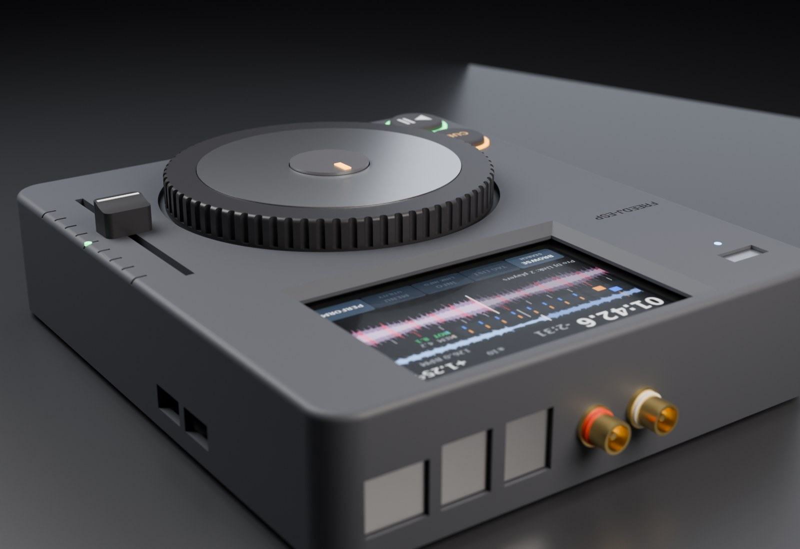
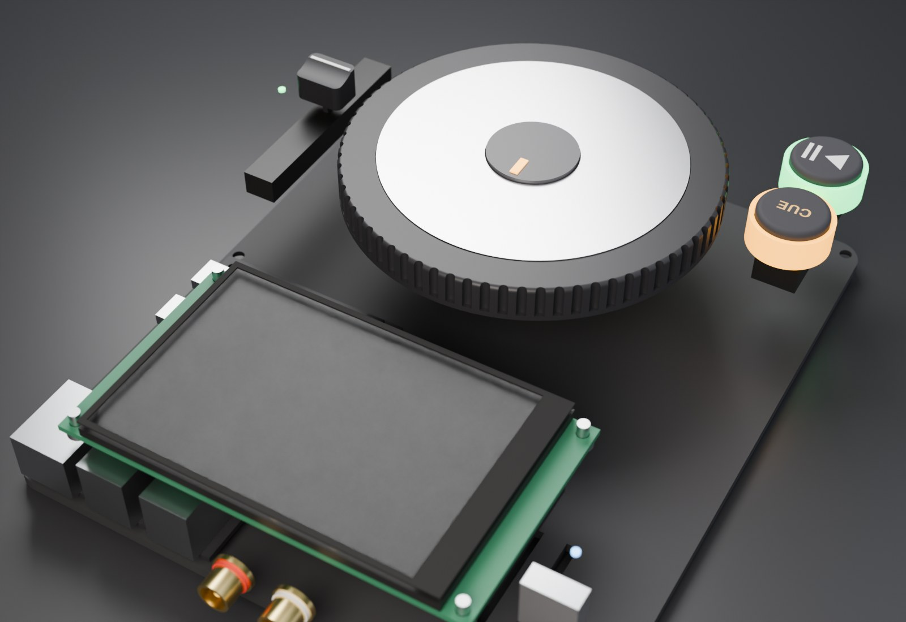
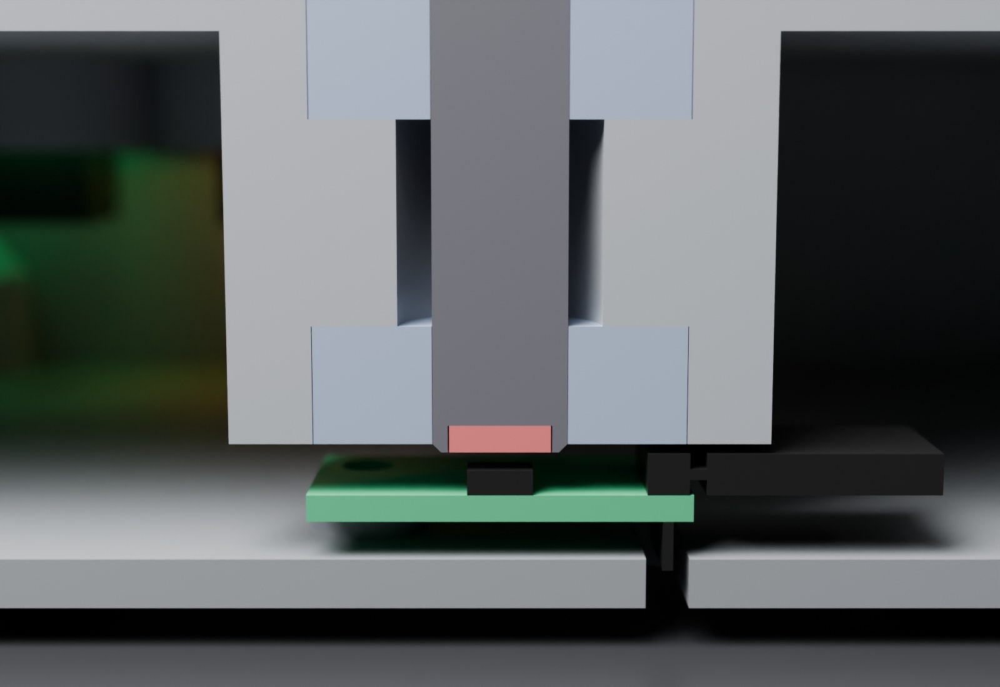
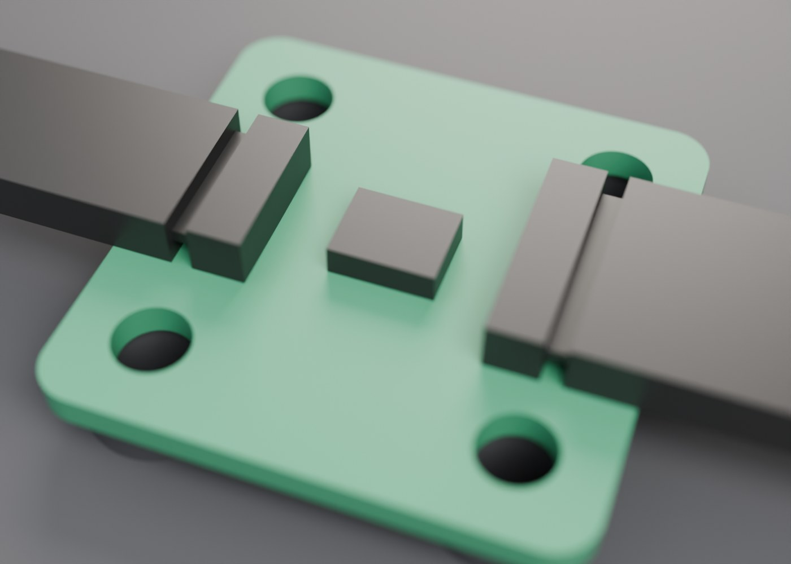
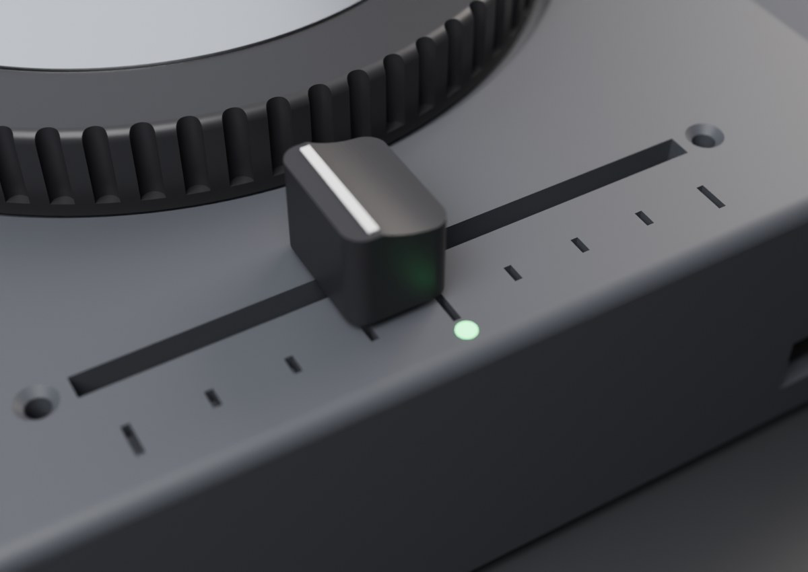
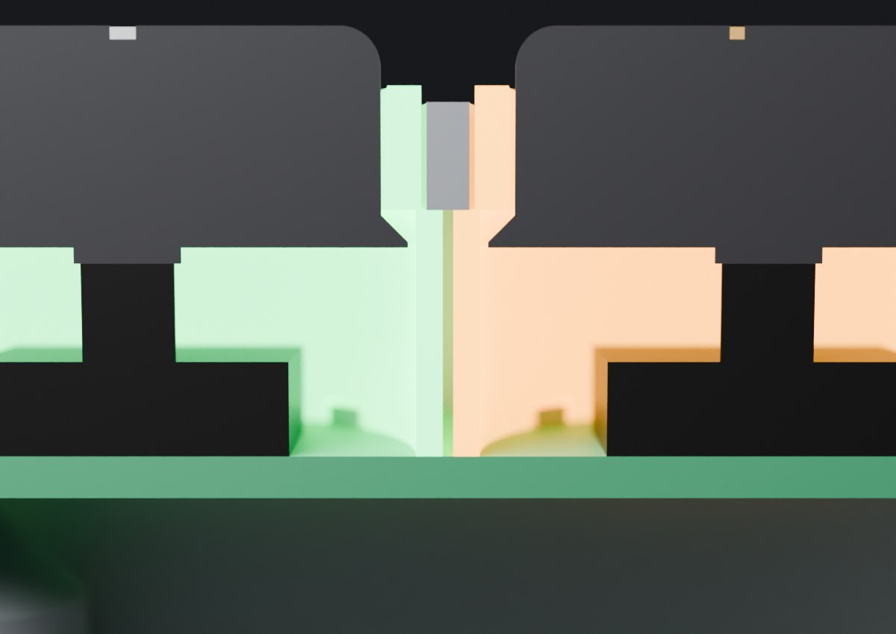
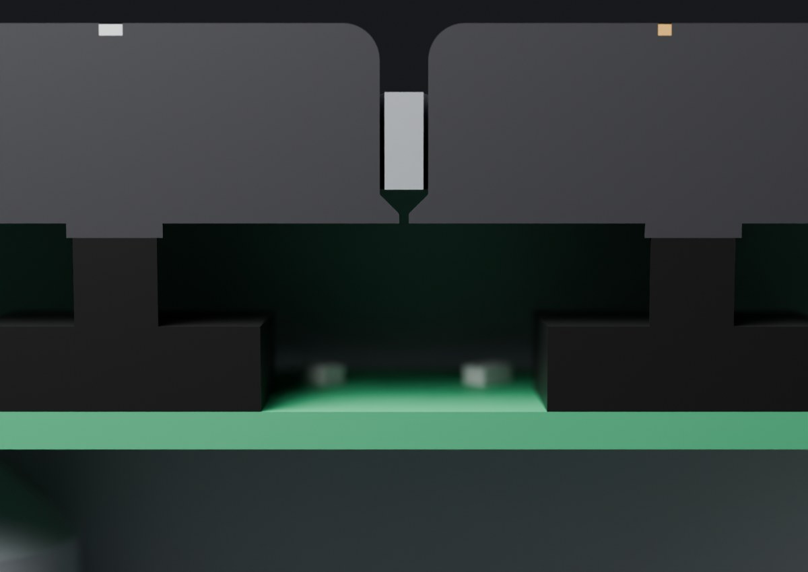
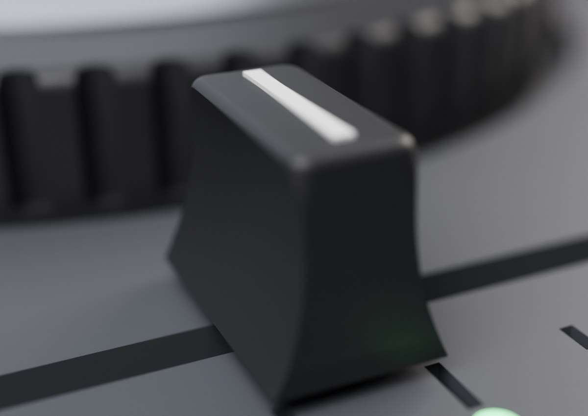
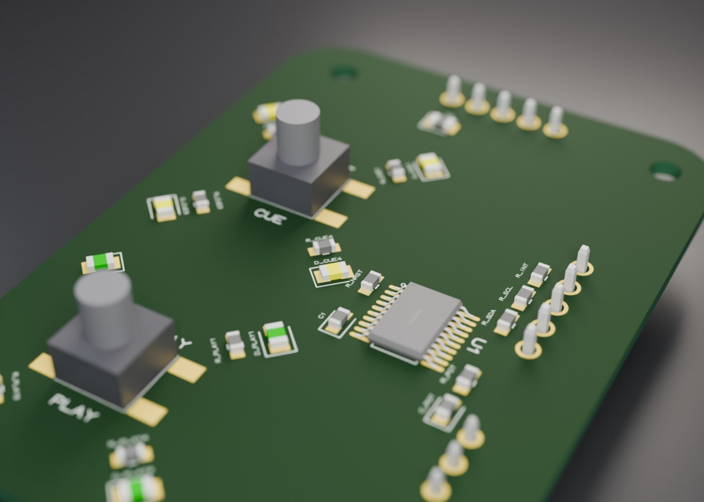
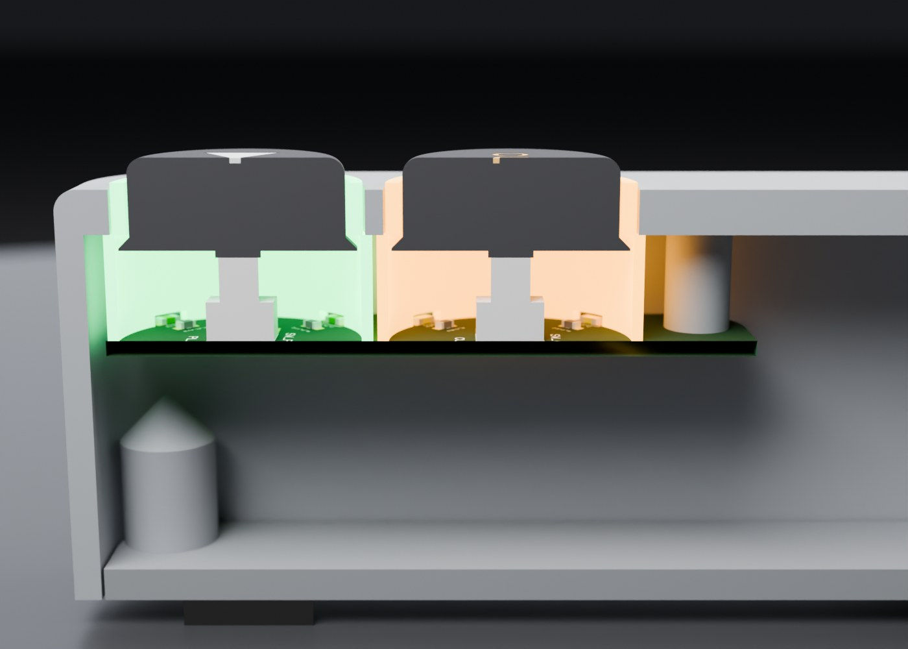

# freedj-esp hardware: a small 3D-printed CDJ

A scaled-down CDJ around the **Hosyond 4" capacitive screen** (LCDwiki MSP4031) the deck already runs on: the CDJ
layout with only a jog wheel, CUE / PLAY and a pitch slider as physical controls,
and the screen at the top. Everything else is touch, on the screen. Designed
2026-10-31; nothing printed yet. (It started around a 3.5" panel, 195 mm deep;
renders 0001–0004 show that version.)


| | |
|---|---|
| Footprint | **160 × 185 mm** (angled; 186 mm flat). Angled: 34 mm tall at the front, 48 mm at the back of the bezel. Flat: 38 mm all over. The top shell fits a 256 mm bed in one piece. The depth is derived from the layout (jog well, an 8 mm gap, the glass with 4 and 5 mm margins), so moving the jog or changing the screen resizes the deck |
| Screen | **Hosyond 4.0" 320×480 capacitive** (ST7796S, FT6336U touch), the panel on the bench. It's the LCDwiki/QDtech **MSP4031** module ([drawing](https://www.lcdwiki.com/res/MSP4030_MSP4031/4.0inch_SPI_Module_MSP4031_Size.pdf)): 108.00 × 60.88 mm board, 60.88 × 94.57 mm glass centred on it, 4.85 mm of glass and tape above the board, 14.8 mm deep with the header. The screen sits **behind the top**: a window shows only the visible area (active area + 0.5 mm, 2.88 mm off-centre away from the header end, as on the panel), straight for 1 mm then chamfered 45° so a finger reaches the edges of the touch area. A 0.5 mm foam gasket sits between the glass and the top. **Four bosses come down from the top to the board** on its four Ø3.2 mounting holes (102.00 × 54.88 mm apart): 6.8 mm OD, with 2.5 mm pilots 6 mm deep for M3 × 5 thread-forming screws (about 3.3 mm of plastic left under the face). The **window is centred on the deck** (and over the jog); the module sits 2.88 mm left of it to make up for its off-centre active area |
| Jog | 100 mm printed platter, knurled rim, with its **shaft printed in one piece** (Ø8.0, a press fit in the 608's 8 mm bore; 7.95 printed loose. `fit_gauge.stl` has 7.95–8.10 pins to tune it). The shaft runs through **two 608 skateboard bearings** pressed into a boss under the top, and the platter's hub sits on the upper inner race. **Nothing holds it down yet**: lift it and it comes out (retention later). Shaft below the platter: **27.0 mm flat, 23.0 mm angled** (the flat shell is 4 mm taller). Print the platter upside down, shaft up: only the touch-plate recess needs support. Steel inertia ring (r 38–46 mm, 5 mm) in the platter's underside. Aluminium top plate, which doubles as the capacitive touch electrode. **Optional Pioneer-style platter** (`pioneer_platter.py` → `platter_pioneer.stl` / `_flat`), modelled on a reference mesh. It has a 2.5 mm base band, then a 45° shoulder with 24 oval finger dimples, then a flat top whose centre seats the same touch plate. Hollow skirt and hub from freedj-3000's jog wheel. The skirt locates the inertia ring, and the same shaft, bearings, cap and encoder are used. 38 cm³ against 61. `FREEDJ_PLATTER=pioneer` puts it in the assembly |
| Jog sensing | Ø6 × ~1.6 mm diametric magnet **glued flush into a pocket in the shaft tip** (the pocket centres it on the axis), **1.1 mm over an AS5600** breakout (WWZMDiB): 15/16" (23.8 mm) square, four Ø3.5 corner holes 5/8" (15.9 mm) apart, chip in the middle. The board sits chip up, centred under the shaft, on **four 2.3 mm bosses** (7 mm OD) on the base plate with small M3 heat-set inserts. Its two pin columns sit either side of the chip (VCC/OUT/GND left, DIR/SCL/SDA/GPO right); with right-angle headers the plugs point out to the sides and clear the bearing boss by 0.6 mm. Shallow pockets under both columns take the solder tails; the right one notches the top-right boss, leaving 0.55 mm of wall round its insert. The stack is set by the printed shell: lower bearing at z 10, shaft tip at 9.5 (0.5 mm lead-in), magnet face 9.5, chip top 8.4, board 5.3–6.9. A magnet 0.4 mm thicker or thinner than 1.6 moves the gap to 0.7 or 1.5 mm, inside the AS5600's 0.5–3 mm |
| CUE / PLAY | Bottom left as on a CDJ. Each button is **a cap and a translucent light ring (amber, green), both put in from below and held by the control board**, with no glue. The ring is a Ø22 tube in the top's Ø22.4 hole, 0.6 mm proud. It has a **Ø23.6 skirt (1 mm wall)** from the top's underside down to the board: the step bears on the underside and the board clamps the skirt. The skirt carries four 0805 LEDs' light up to the ring, with notches in its foot over the LEDs. The Ø19 cap has a **Ø21 flange** under the ring tube, so it can't come out the top, and a **Ø4 nub** onto a **6 × 6 mm SMD tact switch, 7.5 mm tall** (ZX-QC66-7.5TP). It rests on the switch, 0.2 mm under the ring at rest. The flange is chamfered 45° on top, so the cap prints upside down with no supports. Assembly: cap into the ring from the skirt end, ring into the top from below, screw the board on. PLAY and CUE are 24 mm apart, so the skirts are 0.4 mm apart. **Plain version, no rings** (`play_cap_plain.stl`, `cue_cap_plain.stl`): a Ø22 cap fills the top's hole itself, and its Ø23.6 flange catches the top's underside. It uses the same shell, board, switch and nub, so the LEDs are optional. A plain cap printed in translucent filament picks up the LEDs' light, since they sit right under its flange. `FREEDJ_BUTTONS=plain` puts plain caps in the assembly and the clash check |
| Pitch | **Bourns PTA6043-2015DPB103**: 60 mm travel, no centre detent (as on the CDJ-3000; zero is a firmware tempo reset, shown by the green tempo-zero LED), 15 mm metal lever, 10 kΩ linear ([datasheet](https://users.ece.utexas.edu/~valvano/mspm0/BournsPTASlidePotentiometer.pdf)). Its 75 × 9 mm frame hangs under the top on **two 3 mm pads**, held by **two M2 × 8 countersunk screws** from above into the frame's tapped holes (71 mm apart). They're flush, because a pan head would catch the knob at the ends of the travel. The slot is travel + lever + 0.6 = **64.6 mm** (was 74), centred on the jog. Each screw hole is 2 mm from the slot end (1.2 mm at the countersink rim). The knob is **CDJ-style**: 14 mm across the slot, tapering from an 11 mm base to a 12 × 5.5 mm flat top, 10 mm tall, with concave finger scoops front and back and a white index line across the top (paint it in). It's a push fit on the lever (1.4 × 4.3 mm socket, 7.2 deep), rides 1 mm above the top, and prints upright, socket down. The pot is **wired to the control board**: three wires soldered to its PC pins, with a JST-XH plug at the board end. Ticks span the 60 mm travel, starting 6 mm right of the slot. The ticks and the LED stay off the 2 mm edge round. In the angled version the frame's back end is 1.5 mm into the dev board's footprint in plan, but 9 mm above its tallest part there |
| Control board | **One PCB under CUE / PLAY**, 42 × 58 mm, designed in [`ctrl-pcb/`](ctrl-pcb/README.md) (tscircuit, routed and DRC-clean, JLCPCB fab files in `ctrl-pcb/fab/`). A **CH32V003** I2C target does the fader ADC, button debouncing and the 8 ring LEDs; the AS5600 shares the I2C bus through the board. **Top side (all SMD, one-side assembly):** the two 6 × 6 × 7.5 mm tact switches, four 0805 LEDs per button on r 11.3 under the ring skirts (notched over them), a resistor per LED inside the skirt, and the MCU with its passives right of the buttons. **Bottom side:** three JST-XH, plugged from below: fader (3) and AS5600 (5: 3V3, GND, DIR, SCL, SDA) on the right edge, the dev board (5: 3V3, GND, SDA, SCL, INT) off the back edge, plus SWIO programming pads. On the P4, use a **separate I2C bus** from the codec/touch one. The board's top face is 6 + 7.5 mm under the top surface (z 20.5 angled, 24.5 flat). **Three bosses come down from the top** (6 mm OD), with 2.2 mm pilots for M2.5 × 6 thread-forming screws from below. The outline, holes, switch centres, LED circle and connector positions come from this CAD (`ctrl-pcb/gen_geom.py`). The board also **holds the buttons in**, so it's needed even before the electronics work |
| Top | USB-A stick slot left of the screen (up the bezel, clear of the screen bosses) with an activity LED; "FREEDJ" engraved below it |
| Dev board | The **Waveshare ESP32-P4-Module-DEV-KIT** (Raspberry Pi B+ footprint: 85 × 56 mm, M2.5 holes 58 × 49 mm apart, 3.5 mm from the edges, per [Waveshare's drawing](https://docs.waveshare.com/ESP32-P4-Module-DEV-KIT)) sits back-right, under the screen, clear of the back-right base boss, on **four 3 mm standoffs printed on the base plate**, 8 mm across, with small M3 heat-set inserts (Ø4.0 bore, 4.5 deep: M3 × 3 or × 4). The board's holes are 2.75 mm (M2.5), so open them to 3.2 mm for M3 screws. Its port end faces the back: **Ethernet and both USB-A pairs come straight out the rear wall**. Its USB-C edge faces right: **power and the USB-to-UART port come out the right side** through openings sized for the plug's overmould (the sockets are about 11 mm in from the outside, so the overmould goes into the wall; very bulky plugs may need a short USB-C extension) |
| Rear | The dev board's Ethernet (Pro DJ Link) and 2 × dual USB-A (DJ2Go etc.); RCA L/R line out (PCM5102A, not placed yet) to their left |
| Assembly | The base plate screws into **four corner bosses** (M3 countersunk into M3 × 5.7 heat-set inserts). Each boss is 9 mm across and 10 mm tall, fused into the two walls, with a 45° cone above it so it prints without supports upside down; being short, they stay clear of the buttons, the USB slot, the screen and the dev board. Rubber feet |

## Two versions

| | Angled (the design) | Flat (print this one first) |
|---|---|---|
| Screen | On a 12° bezel, as on a CDJ | Flat in the top |
| Height | 34 mm front, 48 mm back | 38 mm all over: 4 mm more, because the dev board's USB-A stacks (about 23 mm up) sit under the screen, and the flat top has no bezel rise to clear them |
| Printing the shell | Upside down, but the bezel slope then needs supports under the back half | Upside down, flat on the top: no supports. The bearing boss and posts grow straight up from it |
| Build | `python3 shell.py`, `python3 machine.py` | `FREEDJ_CONFIG=flat python3 shell.py` → `build/shell_flat.stl`, `python3 machine_flat.py` |

Buttons, slider and connectors are the same parts in both. Three printed parts differ:
the shell, the **base plate** (`base_flat.stl` is 1.6 mm deeper) and the **platter** (its
printed shaft is 4 mm longer in `platter_flat.stl`). Build each with `FREEDJ_CONFIG=flat`.
On the flat print, the engraved "FREEDJ" and the slider ticks are on the bed side, so
they come out as clean as the bed surface allows.






















## Screen options (for the parametric freedj-1000)

The 4" is what the CAD uses today. The 3.5" numbers come from LCDwiki's
[MSP3520 drawing](https://www.lcdwiki.com/res/MSP3520/MSP3520_Size.pdf) (the red board
sold with a stylus), not measured yet. Both are drawn portrait, with the 14-pin header
at the bottom.

| | 4" MSP4031 (Hosyond, current) | 3.5" MSP3520 |
|---|---|---|
| Controller | ST7796S | **ILI9488** |
| Touch | Capacitive, FT6336U on I2C | **Resistive**, XPT2046 on SPI (T_CLK, T_CS, T_DIN, T_DO, T_IRQ) |
| Board | 60.88 × 108.00 × 1.6 | 56.34 × 98.00 × 1.6 |
| Holes | 4 × Ø3.2, 54.88 × 102.00, 3.00 in | 4 × Ø3.2 (Ø4.7 pads), **49.50 × 92.00**, 3.42 / 3.00 in |
| Glass / panel outline | 60.88 × 94.57, centred | 55.50 × 84.96, centred across, 6.54 from the top / 6.50 from the bottom |
| Active area | 55.68 × 83.52, 2.88 off-centre away from the header | **48.96 × 73.44**, centred across, **9.95 from the top, 14.61 from the bottom**: 2.33 off-centre away from the header |
| Stack above the board | 4.85 (CTP 1.35, tape 0.5, TFT 2.5, tape 0.5) | 4.20 (RTP 1.2, TFT 2.5, tape 0.5) |
| Depth with header | 14.8 | 14.18 |
| Other | | microSD socket on the back; 4-pin SD header at the top edge |

The 3.5" window shrinks the deck by about 6 mm in depth (glass 55.5 vs 60.9 mm tall in
landscape). Width doesn't change, because the jog and slider set it.

Two firmware catches with the ILI9488 over SPI:
- **It can't take 16-bit RGB565 over SPI, only 18-bit** (3 bytes per pixel). Every frame
  is 50 % more SPI traffic, so at 40 MHz expect roughly 2/3 of the 4" frame rate (about
  27 fps where the 4" does 41). LVGL needs a convert-to-RGB666 step in the flush.
- **Resistive touch** needs an XPT2046 driver and calibration. It works with the stylus
  or a fingernail, but finger swipes aren't as smooth as on the capacitive 4".

## Open questions

- **Screen dimensions are from the MSP4031 drawing**, not measured. The Hosyond
  listing doesn't publish a drawing, and Hosyond usually resells these LCDwiki
  modules, but check with calipers before printing: the hole spacing (102.00 ×
  54.88 mm), the glass outline (94.57 × 60.88) and that the glass is centred on
  the board. They're all in `machine_params.py`. The resistive MSP4021 is slightly
  different (108.04 × 61.74 board, 102.04 × 54.90 holes).
- **The stick slot on top** has nothing behind it yet. Run a short USB-A extension
  (panel-mount female at the slot) from one of the dev board's USB-A ports, or drop the
  slot and use the rear ports.
- **Dev board heights are typical, not measured:** USB-A stacks 15.6 mm, Ethernet
  13.5 mm. In the flat version the USB-A tops are about 1.7 mm below the screen's
  board components; check yours before printing.
- **Jog top touch:** capacitive through the aluminium plate (first choice), or a
  floating platter on a microswitch. Capacitive needs a P4 touch-capable pin free.
  This is what lets the deck scratch while playing, not only when paused.
- **AS5600 board:** size and hole spacing measured with a ruler, pin columns placed
  from the listing photo (±0.5 mm). Check that the tails land in the pockets.
- **Magnet:** Ø6 assumed, 1.6 mm thick (`MAGNET`). Check the diameter: the pocket is
  Ø6.16.
- **Platter retention:** none yet. Options for later: a drop of retaining compound on
  the lower inner race, or a clip, which needs the lower bearing moved up in the shell.
- **AS5600 output:** I2C (fixed address 0x36, free on the bus: codec 0x18, touch
  0x38), or its analog/PWM OUT pin. It has no A/B quadrature, so not the pulse counter.
  The I2C angle read needs polling at about 1 kHz for scratching; OUT into the ADC is
  the cheaper alternative.
- **Firmware:** a native input driver (pulse counter, ADC, GPIO, touch) that feeds
  the same `DeckEvent`s the DJ2Go does today.

## Suggested build order

1. The jog module alone, wired to the dev board. Feel is the product and the riskiest part.
2. Slider and buttons on a test plate.
3. The shell and base, once the board fit is measured.

## CAD

build123d, parametric. Every shared dimension is in `cad/machine_params.py`, and
parts are placed by named mate points, so changing a number moves everything
that depends on it.

| File | What |
|---|---|
| `machine_params.py` | All shared dimensions, and `place()` |
| `shell.py` | Top shell: jog bearing boss, button holes, control board bosses, pitch slot with the pot's pads and countersunk M2 holes, screen opening and its 4 screw bosses, rear cutouts |
| `base.py` | Base plate and feet |
| `jog.py` | Platter with its printed shaft, shaft fit gauge, touch plate, centre cap, inertia ring, bearings, magnet, AS5600 board and header |
| `controls.py` | Button caps and light rings (printable), slider knob, PTA6043 pot stand-in, LEDs |
| `ctrlboard.py` | Control board: outline (DXF), holes, switch/LED/connector positions, stand-ins |
| `ctrl_fit.py` | The **populated** control board (tscircuit GLB, real part models) placed in the deck: test-fit STLs (`build/ctrl_board_pop{,_flat}.stl` in the deck frame, `build/ctrl_board_pop_local.stl` alone; `build/ctrl_board_print.stl` is a printable stand-in, one solid without the connectors, printed flat), a clash check against the shell, rings, caps and base, and render scenes |
| `stock.py` | Bought parts as stand-ins: LCD (touch glass, TFT, board, header), screws, connectors |
| `devboard.py` | The Waveshare dev board stand-in (board, ports, header, module) and its placement in the deck |
| `machine.py` | The assembly, exported as GLB (plus a cutaway through the jog) |
| `machine_flat.py` | The same assembly in the flat-top configuration |
| `screen_mock.py` | A picture of the play screen for the render, laid out from `main/ui.cpp`. The waveform is synthetic |
| `deck_render.py` | Headless Blender render (Cycles, GPU) |

```bash
cd p4/deck/hardware/cad
python3 shell.py; python3 base.py; python3 jog.py; python3 controls.py   # printable STLs in build/, each checked watertight
FREEDJ_CONFIG=flat python3 shell.py; FREEDJ_CONFIG=flat python3 base.py; FREEDJ_CONFIG=flat python3 jog.py   # the flat set
python3 screen_mock.py && python3 machine.py                            # build/freedj_esp.glb, build/freedj_esp_cut.glb
LC_ALL=C LANG=C blender -b -P deck_render.py -- build/freedj_esp.glb build/hero.png --dist 3.4
LC_ALL=C LANG=C blender -b -P deck_render.py -- build/freedj_esp_cut.glb build/cut.png \
    --az 90 --el 14 --dist 2.0 --target 0.08,0.07,0.022 --exposure -0.3
```

Renders worth keeping go in `cad/renders/freedj_esp/` with a line in its `INDEX.md`.

## License

Copyright (c) 2026 Dan Newcome. The hardware in this directory (CAD sources,
the STL/DXF/GLB files they generate, renders and these docs) is licensed under
the [CERN-OHL-S-2.0](LICENSE). If you make and ship a deck from it, publish
your changed design under the same licence, and show the source location
(<https://github.com/audiodestrukt/freedj-esp>) on the case or in its docs.
The firmware is GPL-3.0-or-later; see [COPYRIGHT.md](../../../COPYRIGHT.md).
