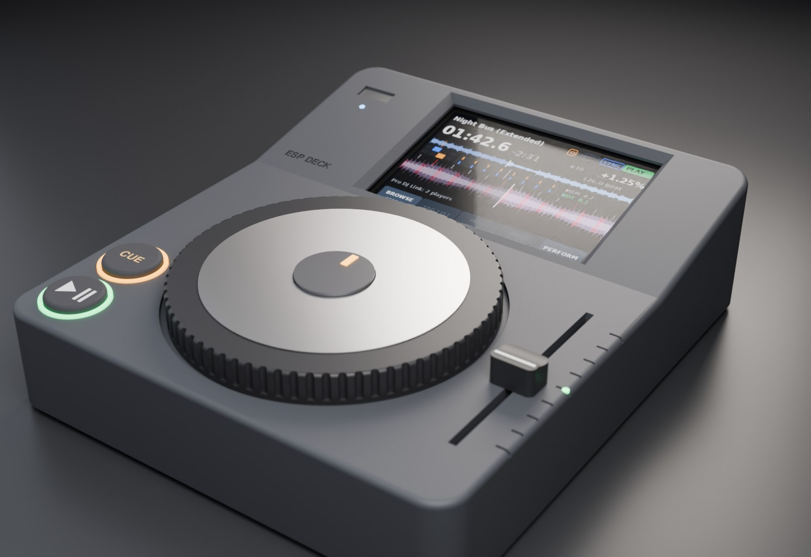
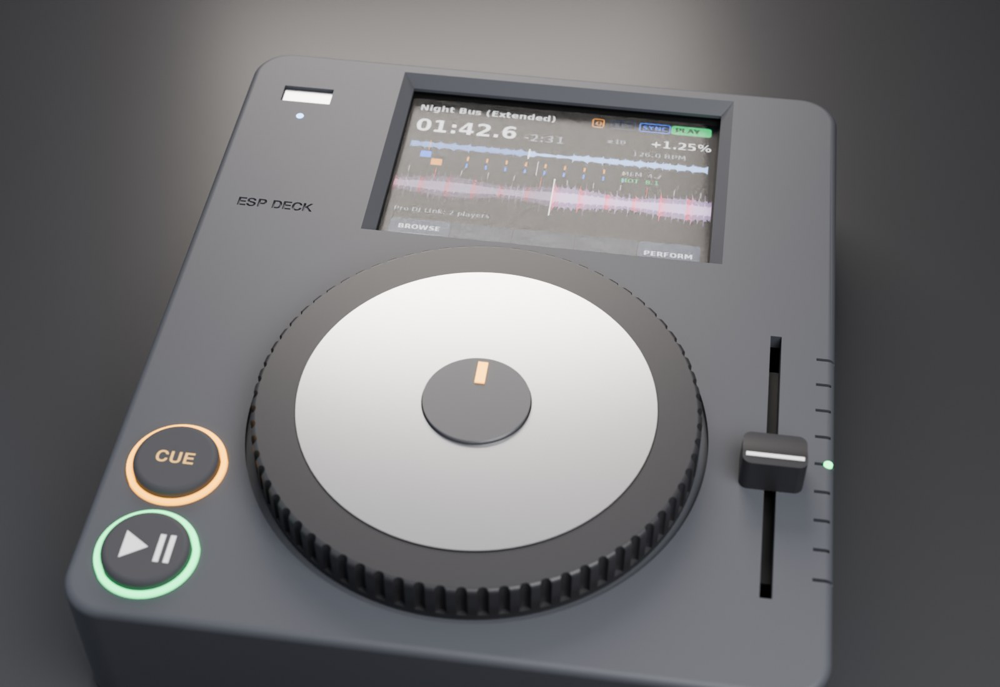
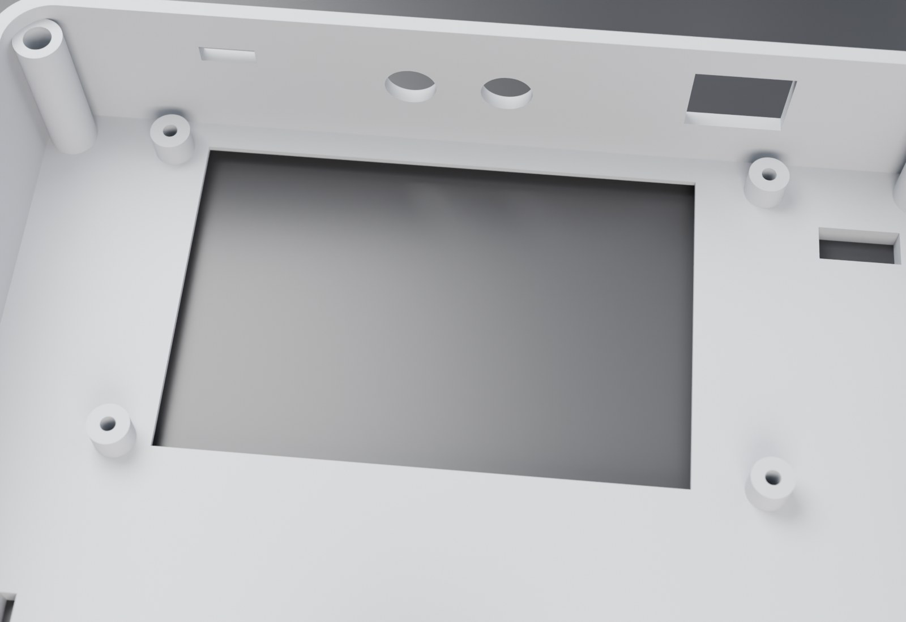
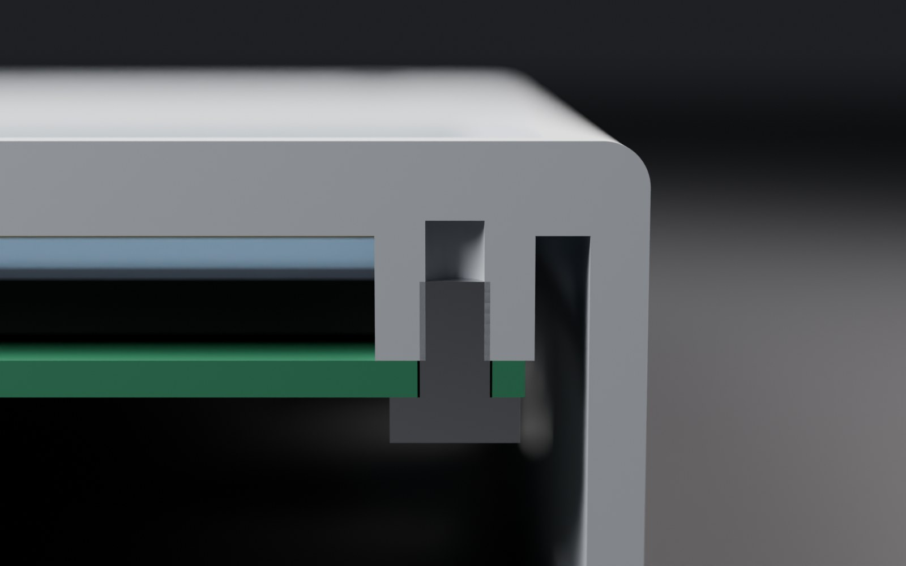
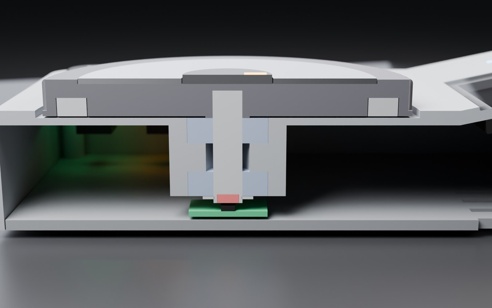

# freedj-esp hardware: a small 3D-printed CDJ

A scaled-down CDJ around the **Hosyond 4" capacitive screen** (LCDwiki MSP4031) the deck already runs on: the CDJ
layout with only a jog wheel, CUE / PLAY and a pitch slider as physical controls,
and the screen at the top. Everything else is touch, on the screen. Designed
2026-10-31; nothing printed yet. (It started around a 3.5" panel, 195 mm deep;
renders 0001–0004 show that version.)



| | |
|---|---|
| Footprint | **160 × 185 mm** (angled; 186 mm flat), 34 mm tall at the front, 48 mm at the back of the angled bezel. The top shell fits a 256 mm bed in one piece. The depth is derived from the layout (jog well, an 8 mm gap, the glass with 4 and 5 mm margins), so moving the jog or changing the screen resizes the deck |
| Screen | **Hosyond 4.0" 320×480 capacitive** (ST7796S, FT6336U touch), the panel on the bench. It's the LCDwiki/QDtech **MSP4031** module ([drawing](https://www.lcdwiki.com/res/MSP4030_MSP4031/4.0inch_SPI_Module_MSP4031_Size.pdf)): 108.00 × 60.88 mm board, 60.88 × 94.57 mm glass centred on it, 4.85 mm of glass and tape above the board, 14.8 mm deep with the header. The screen sits **behind the top**: a window shows only the visible area (active area + 0.5 mm, 2.88 mm off-centre away from the header end, as on the panel), straight for 1 mm then chamfered 45° so a finger reaches the edges of the touch area. A 0.5 mm foam gasket sits between the glass and the top. **Four bosses come down from the top to the board** on its four Ø3.2 mounting holes (102.00 × 54.88 mm apart): 6.8 mm OD, with 2.5 mm pilots 6 mm deep for M3 × 5 thread-forming screws (about 3.3 mm of plastic left under the face). Screen centred at x = 84 mm, leaving room for the USB-A slot on the left |
| Jog | 100 mm printed platter, knurled rim, on an **8 mm shaft through two 608 skateboard bearings** pressed into a boss under the top. Steel inertia ring (r 38–46 mm, 5 mm) in the platter's underside. Aluminium top plate, which doubles as the capacitive touch electrode |
| Jog sensing | 6×2.5 mm diametric magnet in the shaft end, 0.9 mm over an **MT6701** on a 22 mm board. A/B quadrature into the P4's pulse counter: no CPU, off the shared I2C bus |
| CUE / PLAY | 19 mm caps in translucent light rings (amber, green), bottom left as on a CDJ, over key switches |
| Pitch | 45 mm slide pot (Bourns PTA4543 class), knob at the right, tick scale, green tempo-zero LED |
| Top | USB-A stick slot left of the screen (up the bezel, clear of the screen bosses) with an activity LED; "FREEDJ-ESP" engraved below it |
| Rear | RJ45 (Pro DJ Link), RCA L/R line out (PCM5102A), USB-C power |
| Assembly | The base plate screws into four corner posts (M3 countersunk into heat-set inserts). Rubber feet |

## Two versions

| | Angled (the design) | Flat (print this one first) |
|---|---|---|
| Screen | On a 12° bezel, as on a CDJ | Flat in the top |
| Height | 34 mm front, 48 mm back | 34 mm all over |
| Printing the shell | Upside down, but the bezel slope then needs supports under the back half | Upside down, flat on the top: no supports. The bearing boss and posts grow straight up from it |
| Build | `python3 shell.py`, `python3 machine.py` | `FREEDJ_CONFIG=flat python3 shell.py` → `build/shell_flat.stl`, `python3 machine_flat.py` |

Everything else (jog, buttons, slider, base plate, connectors) is the same part in both;
only the tilt changes (`TILT` in `machine_params.py`, set by `FREEDJ_CONFIG`).
On the flat print, the engraved "FREEDJ-ESP" and the slider ticks are on the bed side, so
they come out as clean as the bed surface allows.









## Open questions

- **Screen dimensions are from the MSP4031 drawing**, not measured. The Hosyond
  listing doesn't publish a drawing, and Hosyond usually resells these LCDwiki
  modules, but check with calipers before printing: the hole spacing (102.00 ×
  54.88 mm), the glass outline (94.57 × 60.88) and that the glass is centred on
  the board. They're all in `machine_params.py`. The resistive MSP4021 is slightly
  different (108.04 × 61.74 board, 102.04 × 54.90 holes).
- **Does the electronics fit?** Not checked yet: the Waveshare dev board has to fit
  inside 155 × 180 × ~28 mm, around the screen module's 14.8 mm, with its Ethernet, USB and audio reaching the back.
  Measure it before printing the shell. If it doesn't fit, grow the shell or use
  the Olimex board or our own carrier board ([TARGETS.md](../TARGETS.md)).
- **Jog top touch:** capacitive through the aluminium plate (first choice), or a
  floating platter on a microswitch. Capacitive needs a P4 touch-capable pin free.
  This is what lets the deck scratch while playing, not only when paused.
- **Magnet on a steel shaft** weakens and bends the field. If the readings are
  noisy, use a brass or aluminium shaft, or a printed shaft end.
- **Air gap:** 0.9 mm in the model; check against the MT6701 datasheet when
  the board is drawn.
- **Firmware:** a native input driver (pulse counter, ADC, GPIO, touch) that feeds
  the same `DeckEvent`s the DJ2Go does today.

## Suggested build order

1. The jog module alone, wired to the dev board. Feel is the product and the riskiest part.
2. Slider and buttons on a test plate.
3. The shell and base, once the board fit is measured.

## CAD

build123d, parametric. Every shared dimension is in `cad/machine_params.py`, and
parts are placed by named mate points, so changing a number moves everything
that depends on it.

| File | What |
|---|---|
| `machine_params.py` | All shared dimensions, and `place()` |
| `shell.py` | Top shell: jog bearing boss, button holes, pitch slot, screen opening and its 4 screw bosses, rear cutouts |
| `base.py` | Base plate and feet |
| `jog.py` | Platter, touch plate, centre cap, inertia ring, bearings, shaft, magnet, encoder board |
| `controls.py` | Button caps and light rings, slider knob, pot, LEDs |
| `stock.py` | Bought parts as stand-ins: LCD (touch glass, TFT, board, header), screws, connectors |
| `machine.py` | The assembly, exported as GLB (plus a cutaway through the jog) |
| `machine_flat.py` | The same assembly in the flat-top configuration |
| `screen_mock.py` | A picture of the play screen for the render, laid out from `main/ui.cpp`. The waveform is synthetic |
| `deck_render.py` | Headless Blender render (Cycles, GPU) |

```bash
cd p4/deck/hardware/cad
python3 shell.py; python3 base.py; python3 jog.py; python3 controls.py   # printable STLs in build/, each checked watertight
python3 screen_mock.py && python3 machine.py                            # build/freedj_esp.glb, build/freedj_esp_cut.glb
LC_ALL=C LANG=C blender -b -P deck_render.py -- build/freedj_esp.glb build/hero.png --dist 3.4
LC_ALL=C LANG=C blender -b -P deck_render.py -- build/freedj_esp_cut.glb build/cut.png \
    --az 90 --el 14 --dist 2.0 --target 0.08,0.07,0.022 --exposure -0.3
```

Renders worth keeping go in `cad/renders/freedj_esp/` with a line in its `INDEX.md`.
