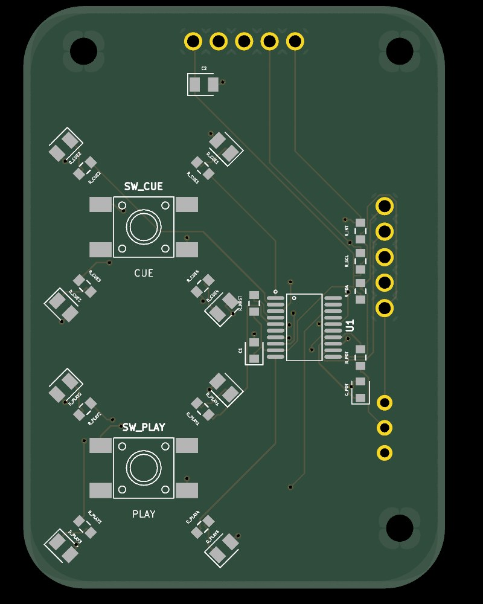
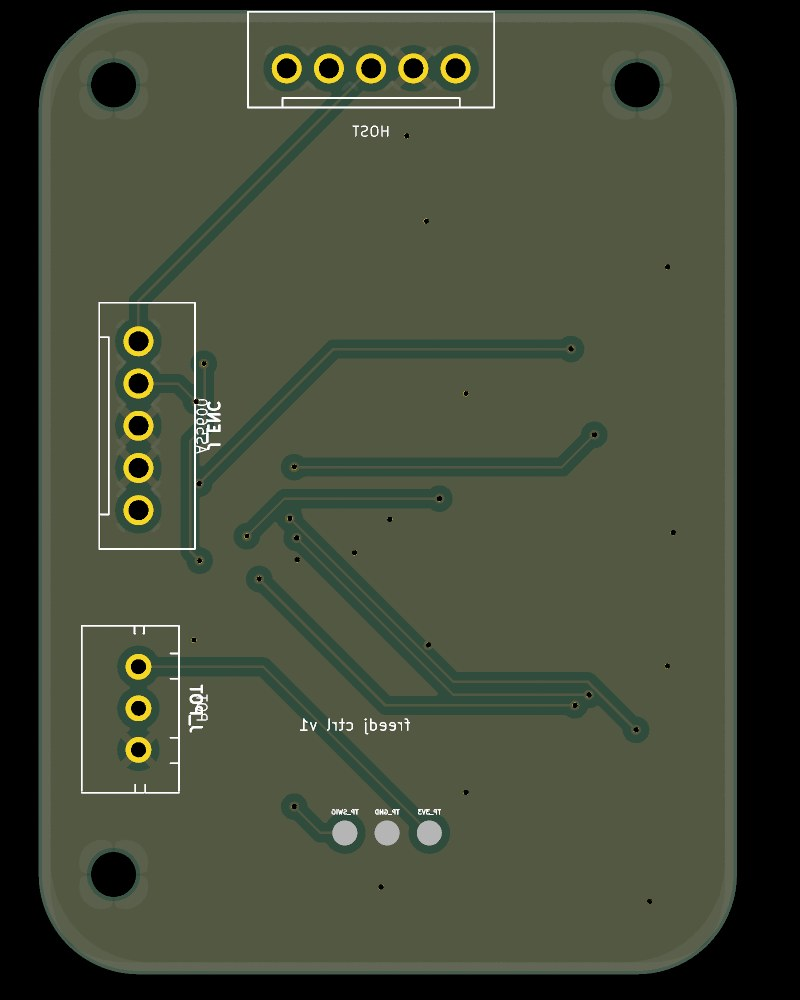

# freedj control board

One 42 × 58 mm two-layer board under CUE / PLAY. It carries:
- the two buttons and their ring LEDs,
- the pitch fader input,
- one I2C target chip that does the ADC, button debouncing and LEDs for the host.

The AS5600 jog encoder shares the same I2C bus through the board. The host is the P4 dev board, a Pi Zero or a Teensy, over a single 5-wire cable.

 

## The chip: CH32V003F4P6

A 32-bit RISC-V microcontroller (WCH), TSSOP-20, LCSC **C5187096**: 26,000+ in stock at JLCPCB, about $0.29.

- **One chip does it all.** It has:
  - a hardware I2C target,
  - a 10-bit ADC for the fader (oversampled in firmware for more resolution),
  - GPIO for the two buttons, debounced in firmware,
  - one pin per LED, so firmware can dim and animate them.
- **Why not fixed-function chips:** an ADC plus a GPIO expander (ADS1015 + PCA9555) would still need firmware-side debouncing, and costs more parts.
- **Why not an ATtiny 1-/2-series:** the ATtiny1616 / 1626 would do the same job, but JLCPCB had only 47–108 in stock.
- **Programming:** one wire (SWIO) from a **WCH-LinkE** (about $5), with 3V3, GND and SWIO on the bottom-side pads. ch32fun or the openwch Arduino core both build for it.

## Pins

| CH32V003 | Use | | CH32V003 | Use |
|---|---|---|---|---|
| 1 PD4 | LED CUE 1 | | 11 PC1 | SDA (I2C target) |
| 2 PD5 | LED CUE 2 | | 12 PC2 | SCL |
| 3 PD6 | LED CUE 3 | | 13 PC3 | INT to host (open drain, 10k pull-up) |
| 4 PD7 | NRST (10k pull-up) | | 14 PC4 | Fader wiper, ADC A2, 1k + 100 nF filter |
| 5 PA1 | LED PLAY 1 | | 15 PC5 | PLAY button (internal pull-up, to GND) |
| 6 PA2 | LED PLAY 2 | | 16 PC6 | CUE button |
| 7 VSS | GND | | 17 PC7 | LED CUE 4 |
| 8 PD0 | LED PLAY 3 | | 18 PD1 | SWIO (programming pad) |
| 9 VDD | 3V3 (100 nF + 10 µF) | | 19 PD2 | spare |
| 10 PC0 | LED PLAY 4 | | 20 PD3 | spare |

LEDs are driven high, with the cathode to GND:
- **PLAY:** KT-0805G green (C2297) with **100 Ω**.
- **CUE:** KT-0805Y 590 nm amber-yellow (C2296) with **470 Ω**.

That's about 3–5 mA each at 3.3 V. Both are JLCPCB basic parts. Use PWM in firmware to match their brightness.

The switches are **ZX-QC66-7.5TP**, 6 × 6 mm SMD, 7.5 mm tall (C7470157). Each is wired across its diagonal pads (1 and 4), which are switched whichever way the contacts pair up inside.

## Connectors (JST-XH, through-hole, soldered on the bottom)

| | Pin 1 | 2 | 3 | 4 | 5 |
|---|---|---|---|---|---|
| **J_HOST** (back edge) | 3V3 | GND | SDA | SCL | INT |
| **J_ENC** (right edge, AS5600) | 3V3 | GND | DIR (tied to GND) | SCL | SDA |
| **J_POT** (right edge, fader) | 3V3 (one end) | wiper | GND (other end) | | |

- **Pull-ups:** I2C has 4.7k pull-ups on this board. On the P4, use a **separate I2C bus** from the codec/touch bus.
- **AS5600:** its address (0x36) doesn't clash with the CH32V003, which will use 0x42 once its firmware exists.

## How it fits the case

The outline, the three M2.5 holes, the switch centres, the LED circle and the connector positions all come from the enclosure CAD:
1. `gen_geom.py` reads them from `../cad/machine_params.py` and `../cad/ctrlboard.py`.
2. It writes them to `lib/geom.json`.
3. `index.circuit.tsx` places from that file.

**Keep-out:** each light ring's skirt sits on r 10.8–11.8 mm around its switch centre. Only the LEDs go there, under notches in the skirt. The bosses come down onto the top face around the holes, so keep r 3 mm there clear too. `build.sh` doesn't check these keep-outs; the checks run were one-off.

## Build

```bash
npm ci                                   # tscircuit, same versions as freedj-3000
ln -s ~/.claude/skills/pcb-layout/scripts scripts
./build.sh
```

`build.sh` does the whole board:
1. Reads the anchors from the CAD.
2. Builds the tscircuit design.
3. Routes it with Freerouting and the capacity router, keeping the better result.
4. Drops dead copper islands.
5. Finishes any open connections with TraceMaker.
6. Runs the gates: KiCad DRC, the JLCPCB DFM check and the floating-pad check.
7. Writes `fab/`.

The tscircuit build reports 34 pad-clearance "errors" between the MCU's own pins. These are false: they come from its rotated pill-shaped pads, and KiCad's DRC on the exported board is clean.

## Ordering (JLCPCB)

- **PCB:** `fab/freedj-ctrl-gerbers.zip`, 2 layers, 1.6 mm.
- **Assembly, top side:**
  - Upload `fab/freedj-ctrl-bom.csv` and `fab/freedj-ctrl-cpl.csv`, which list 27 parts.
  - Check the rotations in JLCPCB's placement preview, especially U1, the LEDs and the switches. Part rotations don't always line up between KiCad and JLCPCB's library.
- **By hand:** the three JST-XH sockets, from `fab/freedj-ctrl-handsolder.csv`. Put the housings on the **bottom** side, where their outlines are on the bottom silkscreen.

## Still to do

- **Firmware for the CH32V003:** I2C register map, debouncing, fader oversampling, LED PWM and the INT line.
- **A host driver on the P4.**
