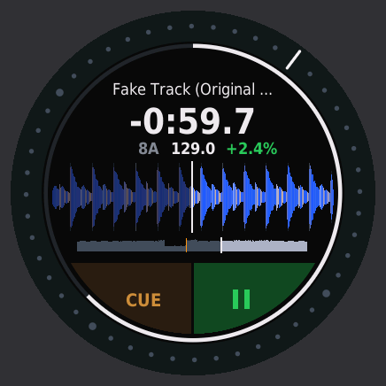
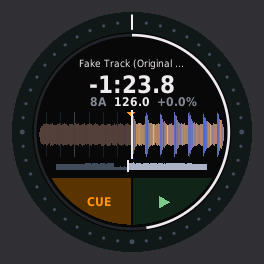

# freedj-esp on the ESP32-S3

A sibling of [p4/deck](../../p4/deck): the deck on S3 boards. One project, a board header per
board. Round screens first:

| Board | Screen | Jog | Status |
|---|---|---|---|
| Waveshare ESP32-S3-Touch-LCD-1.46 (`board_ws146.h`) | 412×412 round, SPD2010 (QSPI), touch | touch round the edge of the glass | the round UI runs, 38.8 fps; no audio or touch yet |
| The puck (`../../../freedj-nano/hw/puck`): XIAO S3 | 240×240 round, GC9A01 | a ring on a bearing, 240 counts a turn | layout previewed at 240 px |

The Waveshare board has a PCM5101 DAC into a speaker amp and **no line or headphone out**.

## The round UI

 

`main/ui/` is plain C++ with no ESP-IDF in it, so the same files build on the PC:

| File | |
|---|---|
| `rgfx.*` | drawing one band of rows at a time: fills, anti-aliased rings, arcs, discs, lines, text |
| `round_ui.*` | the layout. Every size is a fraction of the diameter, so one layout serves 240 and 412 px |
| `fonts.*` | generated by `tools/gen_fonts.py`: DejaVu Sans Condensed, 4-bit anti-aliased |

From the outside in: the jog ring (dots that turn with the platter, a line for its marker; it
lights while touched), a progress arc (red in the last 30 s), title / remaining time / key,
BPM, pitch, the waveform across the middle (the circle's widest part), the track overview,
and CUE | PLAY filling the bottom of the circle so they're big enough to hit on a 37 mm glass.

```
make -C host                 # host/out/*.png: the layout at 412 and 240 px, several states
```

The previews are drawn in the same 32-row bands as the device and checked against one
whole-screen draw. `host/fake_track.bin` is a made-up track's waveform (`tools/fake_track.py`),
embedded in the firmware for the demo.

## Build and flash

```
docker run --rm -v $PWD:/repo -w /repo/s3/deck espressif/idf:release-v5.5 idf.py build
docker run --rm -v $PWD/s3/deck:/d alpine chown -R $(id -u):$(id -g) /d
cd s3/deck/build && esptool --chip esp32s3 -p /dev/ttyACM0 -b 921600 write-flash $(cat flash_args)
```

## Speed (412 px, 240 MHz)

Sending a full frame over QSPI takes 10.3 ms; drawing is overlapped with it (two 32-row
buffers). The S3's FPU is slow for per-pixel work: a dependent multiply-add ~11 cycles,
`sqrtf` ~80, `floorf` ~60. So the rasterisers do the square roots once per row, fill solid
spans directly, and only anti-alias edge pixels.

| | ms a frame |
|---|---|
| clear | 1.4 |
| jog ring | 7.0 |
| progress arc | 7.8 |
| title, time, key / BPM / pitch | 2.7 |
| waveform | 3.2 |
| overview | 0.6 |
| buttons | 0.6 |
| **total drawing** | **23.4 → 38.8 fps** |
